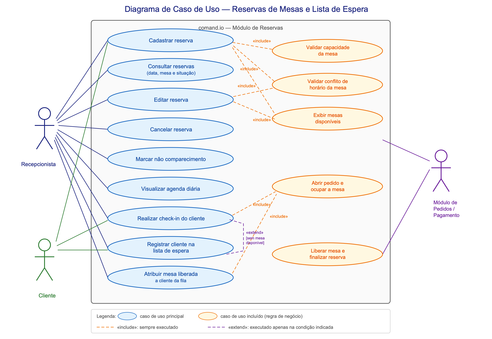
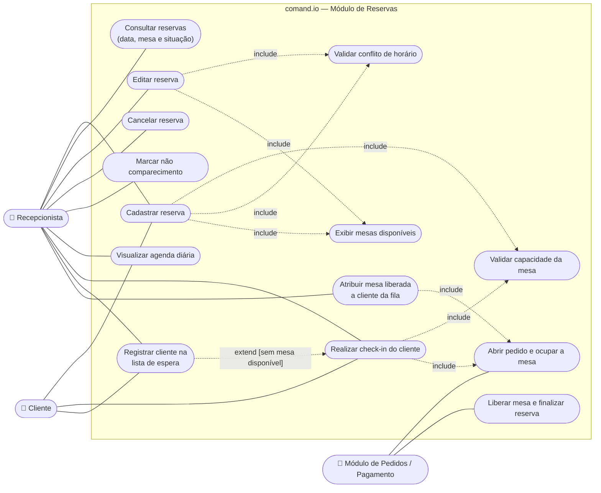
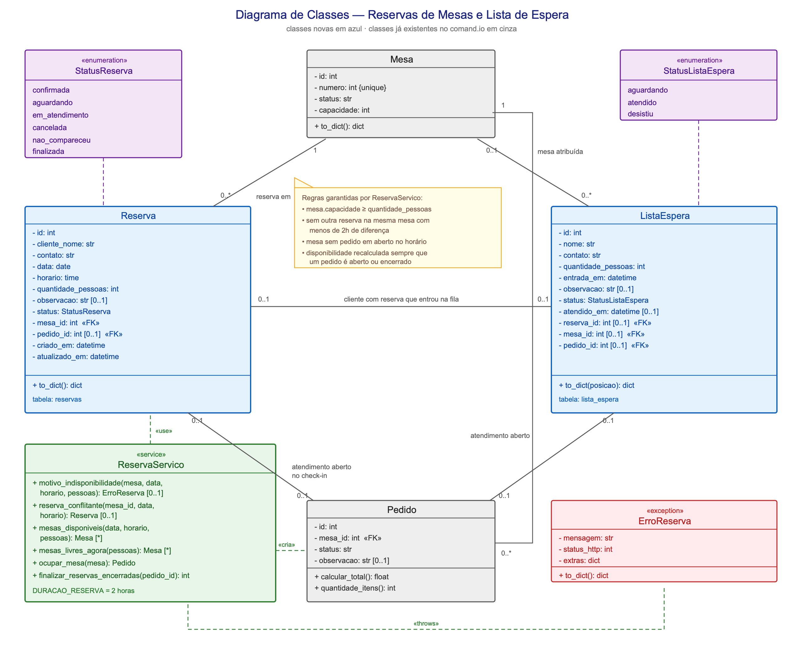
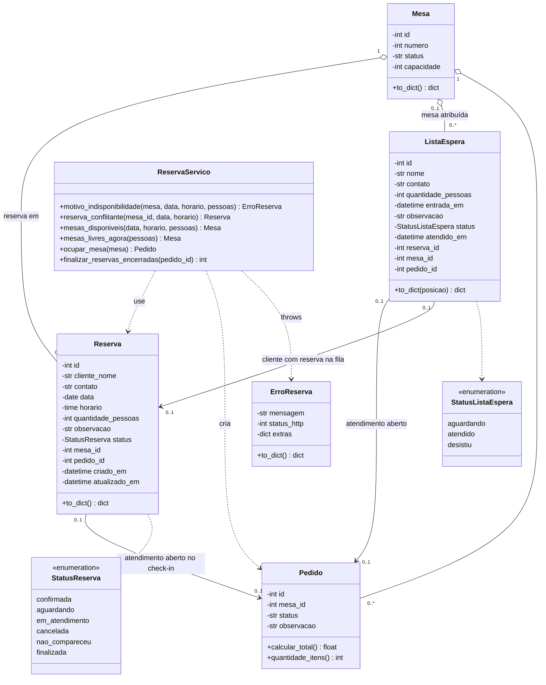
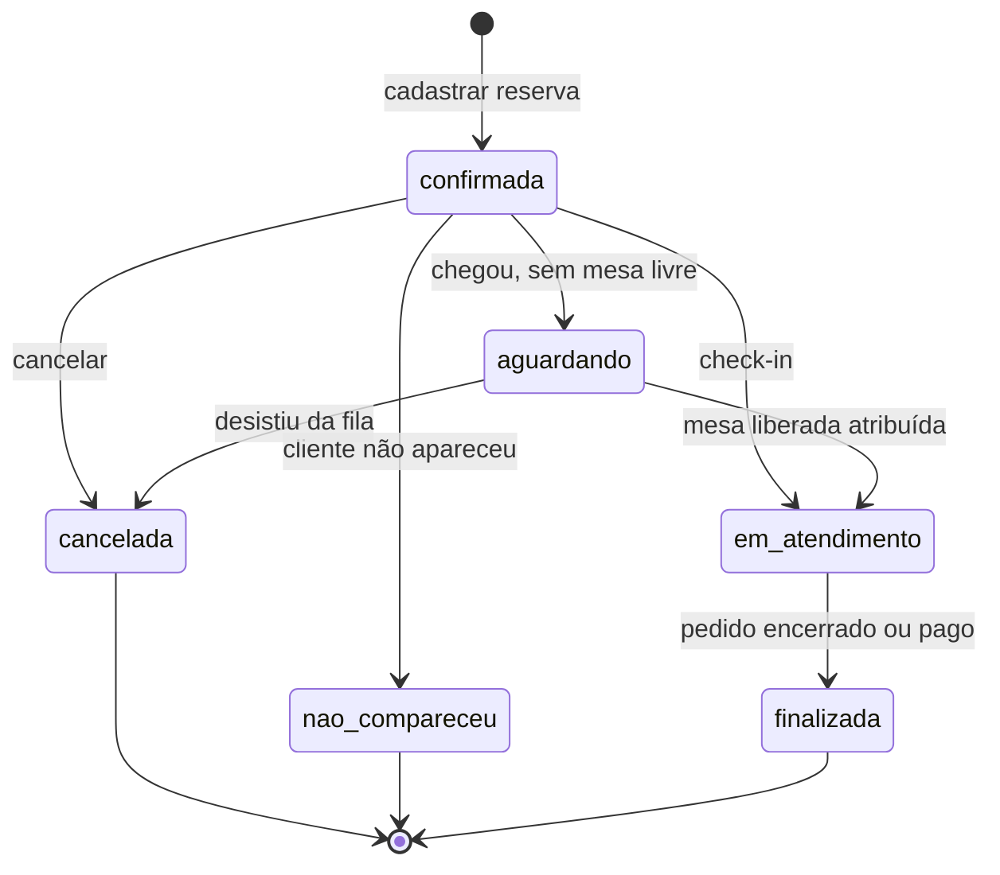

# Reservas de Mesas e Lista de Espera

Documentação de entrega e apresentação da funcionalidade.

- **Tela:** `/recepcao` (links em `/admin` e `/mesas`)
- **Código:** `app/models/reserva.py`, `app/models/lista_espera.py`, `app/reservas/`, `frontend/recepcao.{html,js}`
- **Testes:** `tests/test_reservas.py` (26 testes)
- **Banco:** tabelas `reservas` e `lista_espera` (`docker/mysql/migracao_reservas.sql`)

---

## 1. O que a funcionalidade faz

Permite que a recepção registre reservas antecipadas, associe clientes a mesas de acordo com o
horário e a quantidade de pessoas, evite conflitos e gerencie uma fila de espera. Quando o cliente
chega, a reserva vira atendimento normal na mesa; se não houver mesa disponível, o cliente entra na
lista de espera.

| Requisito | Onde está |
|---|---|
| Estrutura da reserva (cliente, contato, data, horário, pessoas, mesa, observação, status) | `app/models/reserva.py` |
| Status: confirmada, aguardando, em atendimento, cancelada, não compareceu | `StatusReserva` |
| Cadastro de reserva | `POST /reservas` |
| Consulta por data, mesa e status | `GET /reservas?data=&mesa=&status=&busca=` |
| Editar / cancelar | `PUT /reservas/<id>` · `POST /reservas/<id>/cancelar` |
| Validar capacidade da mesa | `servico.motivo_indisponibilidade()` |
| Validar mesa já reservada no horário | `servico.reserva_conflitante()` |
| Exibir mesas disponíveis | `GET /reservas/mesas-disponiveis` |
| Agenda diária | `GET /reservas/agenda?data=` |
| Filtros por data e situação | tela `/recepcao` + parâmetros da consulta |
| Check-in | `POST /reservas/<id>/check-in` |
| Check-in ocupa a mesa e abre o pedido | `servico.ocupar_mesa()` |
| Lista de espera (nome, contato, pessoas, horário de entrada) | `app/models/lista_espera.py` |
| Ordem da fila | `GET /lista-espera` (campo `posicao`) |
| Atribuir mesa liberada a cliente da fila | `POST /lista-espera/<id>/atribuir` |
| Atualizar disponibilidade após cancelamento, check-in e encerramento | disponibilidade calculada em tempo real + `finalizar_reservas_encerradas()` |
| Mensagens claras de erro | `ErroReserva` (mensagem + status HTTP) |
| Testes dos 5 fluxos pedidos | `tests/test_reservas.py` |
| Dados de exemplo | `flask --app run.py dados-exemplo-reservas --recriar` |

---

## 2. Diagrama de Caso de Uso

Arquivos: [`diagrama-caso-de-uso-reservas.png`](diagrama-caso-de-uso-reservas.png) ·
[`diagrama-caso-de-uso-reservas.svg`](diagrama-caso-de-uso-reservas.svg) (vetorial, melhor para slides)

Versão em Mermaid (renderiza no GitHub)

### Caso de uso principal — Realizar check-in (detalhado)

| | |
|---|---|
| **Ator principal** | Recepcionista |
| **Pré-condição** | Reserva com status `confirmada` ou `aguardando`, na data de hoje |
| **Fluxo principal** | 1. Recepcionista localiza a reserva na agenda do dia. 2. Clica em **Check-in**. 3. Sistema valida capacidade e se a mesa está livre agora. 4. Sistema abre o pedido da mesa e marca a mesa como ocupada. 5. Reserva passa para `em_atendimento` e o sistema oferece abrir a comanda. |
| **Fluxo alternativo A** | Mesa ocupada e existe outra mesa livre que comporta o grupo → sistema sugere as mesas e a recepção escolhe uma. |
| **Fluxo alternativo B** | Nenhuma mesa disponível → reserva passa para `aguardando` e o cliente entra na lista de espera. |
| **Pós-condição** | Mesa ocupada, pedido aberto e disponibilidade atualizada. |

---

## 3. Diagrama de Classes

Arquivos: [`diagrama-de-classes-reservas.png`](diagrama-de-classes-reservas.png) ·
[`diagrama-de-classes-reservas.svg`](diagrama-de-classes-reservas.svg)

Versão em Mermaid (renderiza no GitHub)

### Regras garantidas por `ReservaServico`

1. `mesa.capacidade >= quantidade_pessoas`.
2. Nenhuma outra reserva ativa na mesma mesa com menos de **2 horas** de diferença (`DURACAO_RESERVA`).
3. A mesa não pode ter pedido em aberto no horário pedido.
4. A disponibilidade é sempre **calculada na hora**, a partir dos pedidos ativos e das reservas que
   bloqueiam o horário. Por isso ela se atualiza sozinha depois de cancelamento, check-in,
   não comparecimento e encerramento ou pagamento do pedido — não existe campo que possa ficar
   desatualizado.

### Ciclo de vida do status da reserva

---

## 4. Roteiro de apresentação (8 a 10 minutos)

**Antes de começar:** rode `flask --app run.py dados-exemplo-reservas --recriar` para recriar as
reservas de exemplo na data de hoje, deixe `/recepcao` e `/mesas` abertos em abas separadas e tenha
este documento aberto nos diagramas.

| # | Tempo | O que mostrar | O que falar |
|---|---|---|---|
| 1 | 1 min | Diagrama de caso de uso | "O ator principal é a recepcionista. Os casos de uso em laranja são regras de negócio sempre executadas: validar capacidade, validar conflito de horário e exibir mesas disponíveis. A lista de espera **estende** o check-in: só acontece quando não há mesa." |
| 2 | 1 min | Diagrama de classes | "Duas entidades novas, `Reserva` e `ListaEspera`, ligadas a `Mesa` e a `Pedido`, que já existiam. As regras ficam concentradas em `ReservaServico`, fora das rotas, por isso elas são testáveis e reaproveitadas pela tela e pela API." |
| 3 | 1 min | Tela `/recepcao` | Mostrar "Mesas agora", agenda do dia e a fila de espera com a ordem de chegada. |
| 4 | 1 min | Conflito de horário | Cadastrar reserva na **mesa 3 às 20:00**. Mostrar a mensagem de conflito com a reserva das 19:00 e explicar a janela de 2 horas. |
| 5 | 1 min | Capacidade | Tentar reservar a **mesa 1 para 6 pessoas**. Mostrar a mensagem "a mesa 1 comporta até 2 pessoa(s)". |
| 6 | 1 min | Mesas disponíveis | Clicar em **Ver mesas disponíveis** e salvar a reserva, mostrando que só aparecem mesas compatíveis. |
| 7 | 1,5 min | Check-in com mesa ocupada | No `/mesas`, abrir a mesa 1. Voltar e fazer check-in do João: o sistema sugere outra mesa ou a lista de espera. Aceitar a sugestão. |
| 8 | 1,5 min | Check-in normal + comanda | Fazer check-in da Carla, abrir a comanda e adicionar um item, mostrando que vira atendimento normal. |
| 9 | 1 min | Fila + liberação | Encerrar ou pagar um pedido, mostrar a mesa liberada e **atribuir a mesa ao 1º da fila**. Mostrar a reserva virando `finalizada`. |
| 10 | 30 s | Testes | Rodar `python -m unittest tests.test_reservas -v` e mostrar os 26 testes passando. |

### Perguntas prováveis e respostas

- **"Como vocês evitam duas reservas na mesma mesa?"** Cada reserva ocupa a mesa por 2 horas; antes
  de salvar, o sistema procura qualquer reserva ativa da mesma mesa com menos de 2 horas de
  diferença e bloqueia com HTTP 409.
- **"E se a mesa estiver ocupada por quem não tem reserva?"** O check-in também verifica se existe
  pedido em aberto na mesa naquele momento, não apenas outras reservas.
- **"Por que existe o status `finalizada`?"** Para separar "cliente está na mesa" de "atendimento
  terminou". Sem ele, a reserva ficaria como "em atendimento" para sempre depois do pagamento.
- **"Onde estão as regras de negócio?"** Em `app/reservas/servico.py`. As rotas só convertem a
  entrada, chamam o serviço e traduzem o `ErroReserva` em resposta HTTP.
- **"Como vocês testaram?"** 26 testes cobrindo criação, conflito de horário, cancelamento,
  check-in e atendimento da lista de espera, com o relógio fixado para não depender da data real.
